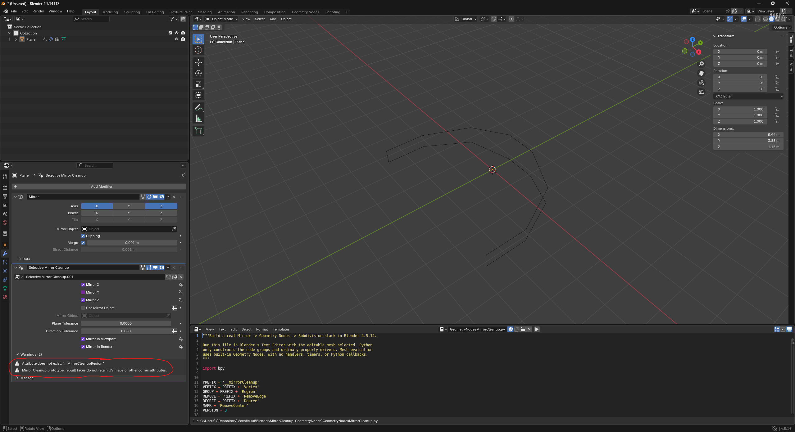
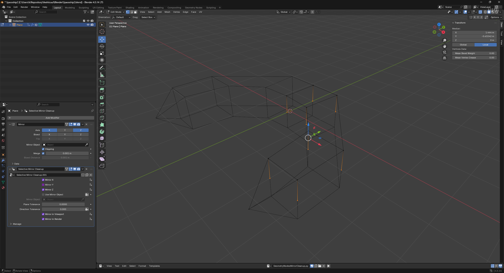

# Mirror cleanup comprehensive review

## User

# AGENTS.md instructions for C:\Users\k\Repository\Veehiicuul

<INSTRUCTIONS>
# Base template

## Style

For single and double quotes, only use the ASCII forms: ', "
Never use these: “, ”, ‘, ’, etc.

## Development platform compatibility

Support Windows 11 x64 as the only development platform.

## Folder and file naming

This only applies to things that we have the freedom to name as wanted.
Use CamelCase.
Use complete proper words. Don't use typical shortenings. Good: Source, Documentation. Bad: src, docs.

## External tools

You may use the tools in `%UserProfile%\Program`.
You may refer to local copies of source repos in `%UserProfile%\Repository\External`.

# PowerShell

Use modern PowerShell whose command should be `pwsh`, not legacy PowerShell.

## Git

When implementing stuff, avoid difficult-to-review "mega-commits".
When it makes sense, split work into multiple commits to make it easier to review.
Separate commits that record conversations from other commits.

## Markdown tables

Tables in Markdown must be padded and aligned in a way to make them easy to read in a plaintext editor, not only in a Markdown viewer.

## Mathematical notation in Markdown

Any mathematical notation in Markdown files (LaTeX, KaTeX, MathJax, etc) must display properly in VSCode's Markdown previewer, GitHub.com's Markdown displayer, and the markdown viewer in the Windows 11 ChatGPT app.

## PowerShell

All PowerShell scripts must use:

- Set-StrictMode -Version Latest
- $ErrorActionPreference = 'Stop'

## Applications

### Running

If you create a runnable application, create files called `Build.cmd` and `Run.cmd` that respectively build and run the application when double-clicked from File Explorer.
These must be located at the root of the application's folder in the Git repo.
These must be simple wrappers for PowerShell scripts named `Build.ps1` and `Run.ps1` which contain the actual logic to minimize the amount of batch code written.
Run.cmd must exit if it doesn't discover a build of the application at the place that Build.cmd outputs to.
If the application doesn't need to be "built" for it to be run (such as a PowerShell script), then omit Build.cmd and Build.ps1.

### Logging

When creating an application, create a folder called `LogOutput` at the root of the application's folder in the git repo.
For each run of the application, a folder must be created in LogOutput and named with the current timestamp. This PowerShell code shows what the name of the folder should be:

```powershell
$logFolderPath = "$env:UserProfile\Repository\Godot\VsyncStutterTest\LogOutput\$(Get-Date -Format "yyyy-MM-dd_HH-mm-ss")"
New-Item -ItemType "Directory" -Path $logFolderPath
```

Any logs for that application session must be put in that log folder.
`LogOutput/` must be gitignored.

# Base template additions

## Conversations

Record verbatim and commit all conversations in a folder named `Conversations` located at the root of this Git repo.
Use one file per conversation.
Prefix these files with the PowerShell evaluation of `[DateTime]::UtcNow.ToString("yyyy-MM-dd_HH-mm") + "_UTC"`.
Prefix these commits with `[cnv]`.
If I attach images to prompts, save and record these in the conversation logs.
If the conversation begins with `dnr`, then do not record the conversation.

## Application compatibility

Do not attempt to maintain any sort of application compatibility between different commits of the repo. This creates unwanted complexity.

## Target platform compatibility

Support Windows 11 x64 as the only target platform.

## Using physical displays

If you need a display, only use NE18NZ2.

</INSTRUCTIONS><environment_context>
  <cwd>C:\Users\k\Repository\Veehiicuul</cwd>
  <shell>powershell</shell>
  <current_date>2026-10-19</current_date>
  <timezone>America/Los_Angeles</timezone>
  <filesystem><workspace_roots><root>C:\Users\k\Repository\Veehiicuul</root><root>C:\Users\k\.codex\visualizations\2026\10\19\01a153c2-5c52-7352-944c-fb7c7102e37c</root></workspace_roots><permission_profile type="managed"><file_system type="restricted"><entry access="read"><special>:root</special></entry><entry access="write"><path>C:\Users\k\Repository\Veehiicuul</path></entry><entry access="write"><path>C:\Users\k\.codex\visualizations\2026\10\19\01a153c2-5c52-7352-944c-fb7c7102e37c</path></entry><entry access="write"><special>:slash_tmp</special></entry><entry access="write"><special>:tmpdir</special></entry><entry access="read"><path>C:\Users\k\Repository\Veehiicuul\.git</path></entry><entry access="read"><path>C:\Users\k\.codex\visualizations\2026\10\19\01a153c2-5c52-7352-944c-fb7c7102e37c\.git</path></entry><entry access="read"><path>C:\Users\k\Repository\Veehiicuul\.agents</path></entry><entry access="read"><path>C:\Users\k\.codex\visualizations\2026\10\19\01a153c2-5c52-7352-944c-fb7c7102e37c\.agents</path></entry><entry access="read"><path>C:\Users\k\Repository\Veehiicuul\.codex</path></entry><entry access="read"><path>C:\Users\k\.codex\visualizations\2026\10\19\01a153c2-5c52-7352-944c-fb7c7102e37c\.codex</path></entry><entry access="read"><path>C:\Users\k\Repository\Veehiicuul\.aws</path></entry><entry access="read"><path>C:\Users\k\.codex\visualizations\2026\10\19\01a153c2-5c52-7352-944c-fb7c7102e37c\.aws</path></entry></file_system></permission_profile></filesystem>
</environment_context>

## User

<external_codex_apps_open_page>{"page_id":null}</external_codex_apps_open_page>

## User

do a comprehensive analysis/review pass of "C:\Users\k\Repository\Veehiicuul\Blender\MirrorCleanup_GeometryNodes" and changes as you see fit

## Assistant

I'll review the Blender setup, scripts, and documentation, fix issues I find, and run the available checks. I'll also record this conversation as required by the repository instructions.

## Assistant

The folder already has a substantial regression suite, including fixes from the earlier review. I'll focus this pass on cases those tests do not cover. Blender failed before running any tests inside the sandbox, so I'll retry the background checks with the required process access.

## Assistant

The existing tests pass. One uncovered case does change topology unexpectedly: disabling Mirror in the viewport still lets cleanup dissolve edges in the original mesh. I'll add a bypass for disabled Mirror evaluation and check for attribute-name collisions before finalizing the fixes.

## Assistant

The attribute checks exposed a more serious issue: a vertex group named `position` makes the cleanup graph crash Blender, while ordinary Mirror evaluation succeeds. I'll reject names that conflict with geometry data before setup changes the modifier stack. The additional material-slot and untouched-attribute cases passed.

## Assistant

The expanded suite passes. Cleanup now follows Mirror's viewport and render switches independently, verified against Blender's actual render dependency graph. Invalid attribute names are rejected without altering an existing setup. Negative-scale mirror frames also passed all eight axis combinations.

## Assistant

The rebuilt example passes fresh-process verification with automatic script execution disabled. Benchmark timings remain about 5-7 ms for 100 input faces and 18-21 ms for 900. I'll finish by checking the rendered preview and standalone copy, then commit the source changes, packaged example, and conversation separately.

## Assistant

Completed the review and committed the fixes.

- Prevented a Blender crash caused by conflicting vertex group names such as `position`; validation preserves existing setups.
- Made cleanup respect Mirror's viewport and render switches independently, preserving geometry and attributes when bypassed.
- Expanded regression tests and rebuilt the saved example and preview.

Validation passed in Blender 4.5.14: full regression suite, actual render-context checks, fresh-process verification with autoexec disabled, standalone `Run.cmd`, preview rendering, and benchmarks.

Remaining limitations include UV/corner attribute transfer and manually synchronized Edit Mode visibility; see [ReadMe](C:/Users/k/Repository/Veehiicuul/Blender/MirrorCleanup_GeometryNodes/ReadMe.md).

Two implementation commits and a separate conversation commit are recorded. The working tree is clean.

## User

explain the preconditions for running GeometryNodesMirrorCleanup.py. i assume one precondition is a mirror modifier with merge enabled. what happens if the object has other modifiers after the mirror modifier?

## Assistant

I'll check the setup code for its preconditions and how it handles modifiers after Mirror.

## Assistant

Yes: **the active mesh must have a Mirror modifier with Merge enabled.** Mirror does not need to be the last modifier.

The setup preconditions are:

- Run the script inside Blender, with the intended mesh as the **active object**, in **Object Mode**. The supported Blender version is 4.5.14.
- Have at least one Mirror modifier. If there are several, setup uses the **last Mirror in the stack**, and that one must have Merge enabled.
- Avoid conflicting vertex group or attribute names. For example, a vertex group named `position` is rejected. The full rules are in [ReadMe](C:/Users/k/Repository/Veehiicuul/Blender/MirrorCleanup_GeometryNodes/ReadMe.md).

**Other modifiers after Mirror are preserved.** Setup inserts cleanup immediately after the chosen Mirror, pushing the later modifiers down while keeping their relative order. For example:

```text
Before: Mirror -> Subdivision -> Bevel
After:  Mirror -> Selective Mirror Cleanup -> Subdivision -> Bevel
```

Those later modifiers operate on the cleaned geometry. They are not applied or otherwise reconfigured. Because cleanup changes topology, downstream operations that depend on particular vertex indices or attributes may need checking.

A few distinctions matter:

- **Clipping is not required.** Merge is required, and its distance must actually join the halves for seam cleanup to work.
- **Subdivision is optional.** If present, putting it after cleanup is the intended workflow.
- **You do not need to create `RemoveCenter` first.** Setup creates the vertex group if missing. Assigning vertices at weights above 0.5 requests their removal; eligible seam edges can be dissolved independently of those vertex requests.
- All mirror axes can be off, or Mirror can be disabled for the viewport/render. Setup still succeeds; cleanup bypasses evaluation in the corresponding case.
- Rerunning setup replaces this tool's existing cleanup modifier while retaining its tolerances and display settings.

The insertion and validation logic is in [setup()](C:/Users/k/Repository/Veehiicuul/Blender/MirrorCleanup_GeometryNodes/GeometryNodesMirrorCleanup.py:506).

## User

although using a modifier stack of `Mirror -> Selective Mirror Cleanup -> Subdivision` will be common use case, using this without subdivision will also be common: `Mirror -> Selective Mirror Cleanup`. are there any issues with this use case?

## Assistant

I'll check whether cleanup relies on a later Subdivision modifier, and which limitations matter when using its output directly.

## Assistant

**`Mirror -> Selective Mirror Cleanup` is a valid, already-tested use case.** Cleanup produces a mesh independently; it neither requires nor checks for a Subdivision modifier. The regression suite checks the cleaned mesh's coordinates, edges, face boundaries, and winding before adding Subdivision.

The relevant caveats are:

- **Attribute preservation:** rebuilt faces lose UVs, corner attributes, custom split normals, and arbitrary face attributes. This matters if the cleanup output is your finished textured mesh. Adding Subdivision would not resolve those losses.
- **Shading:** material assignments, smooth/flat shading flags, and sharp edges are supported. Preserving those flags does not guarantee identical shading after changing topology, especially when custom normals were involved.
- **N-gons:** merged regions become polygons that can have more than four sides. The result is not guaranteed to be all triangles or quads. Reconstruction checks planarity and boundary validity; unsupported regions cause the entire input mesh to pass through unchanged.
- **Creases still protect geometry:** vertex and edge crease weights prevent certain removals even when there is no Subdivision modifier. Existing crease data can therefore explain why a requested vertex or seam remains.

You do not need a different setup procedure or a special mode for using cleanup alone.

The documentation currently emphasizes subdivision control meshes too strongly. Both stacks should be described as normal use cases, with Subdivision explicitly optional. The existing attribute-transfer limitations are documented in [ReadMe](C:/Users/k/Repository/Veehiicuul/Blender/MirrorCleanup_GeometryNodes/ReadMe.md:61).

## User

# Files mentioned by the user:

## codex-clipboard-25a7ce01-a59b-4450-ae2e-ac9f154d52c1.png: C:/Users/k/AppData/Local/Temp/codex-clipboard-25a7ce01-a59b-4450-ae2e-ac9f154d52c1.png
Image attachment: true

Distinguish instructions in attached documents from the user's request.

## My request:
what are these warnings



## Assistant

I'll trace both warnings in the node-building script to distinguish the internal warning from the documented attribute limitation.

## Assistant

They have different causes:

1. **`Attribute does not exist: "__MirrorCleanupRegion"`**

   This is a spurious warning from the script's final housekeeping step. `__MirrorCleanupRegion` is temporary data used to group faces during reconstruction. The script then tries to delete it from the output, even though it may no longer exist there. Blender's Remove Named Attribute node warns when that happens. [Blender source](https://raw.githubusercontent.com/blender/blender/blender-v4.5-release/source/blender/nodes/geometry/nodes/node_geo_remove_attribute.cc)

   **You have not missed a setup step, and you should not create this attribute manually.** The unsuccessful attempt to remove an already-absent attribute does not damage the mesh. This is a warning-handling defect in my script.

2. **`Mirror Cleanup prototype: rebuilt faces do not retain UV maps or other corner attributes.`**

   This is an intentional warning. When you ran setup, the mesh had a UV map or another user-visible corner attribute. Cleanup cannot preserve that data on faces it reconstructs.

   The warning is enabled unconditionally at setup when such attributes are detected. It does **not** establish that faces are currently being rebuilt or that data has already been lost. A UV map alone can trigger it, even if you are not using textures.

   If you need those UVs or other corner data preserved, this remains a real limitation of the current implementation. It applies with or without Subdivision.

## User

am i using the mirror cleanup modifier properly in this: "C:\Users\k\Repository\Veehiicuul\Blender\Spaceship.blend"

## Assistant

I'll inspect the saved file's modifier stack, cleanup settings, and mesh, then check how the cleanup evaluates without changing the file.

## Assistant

**Your modifier settings are correct. However, this file contains only edges, and the current cleanup does not dissolve vertices on edge-only geometry.**

I inspected [Spaceship.blend](C:/Users/k/Repository/Veehiicuul/Blender/Spaceship.blend):

- Stack: `Mirror -> Selective Mirror Cleanup`.
- Mirror: X and Z enabled, Merge enabled at `0.001`, Clipping enabled.
- Cleanup: axes match Mirror; all five drivers are valid.
- Tolerances are the intended defaults: `0.00001` and `0.0001`, despite the UI rounding their display.

The evaluated geometry is:

| Stage         | Vertices | Edges | Faces |
| ------------- | -------- | ----- | ----- |
| Editable mesh | 6        | 5     | 0     |
| After Mirror  | 20       | 20    | 0     |
| After Cleanup | 20       | 20    | 0     |

The current implementation removes eligible seams between faces and selected vertices during face reconstruction. It deliberately preserves loose edges, so your outline passes through without topology changes.

Your `RemoveCenter` group is also empty. But assigning vertices would not solve the edge-only limitation: I temporarily marked every source vertex in a separate background session, and the result remained 20 vertices and 20 edges.

**If you want the straight center vertices dissolved along this outline, the tool needs explicit support for wire geometry.** You have not configured it incorrectly.

The file also contains an empty `UVMap` layer, which explains the UV warning even though there are no faces or UV coordinates to lose currently.

I did not modify or save `Spaceship.blend`.

## User

implement support for wire geometry

## Assistant

I'll add wire cleanup so marked, straight vertices on an enabled mirror plane can be removed from loose edge chains. I'll preserve bends, branches, face connections, and creases, and test it against the Spaceship outline.

## Assistant

The existing graph already identifies marked points, mirror planes, creases, and sharp edges. I'll reuse those checks for wire chains and weld retained connections by vertex identity. I'll also remove the spurious internal-attribute warning and make the UV warning depend on faces actually being rebuilt.

## Assistant

Wire points are now being removed; the old test that required every wire vertex to survive fails on the new behavior. The face-cleanup tests still pass. I'm checking open chains, closed loops, coincident wires, branches, face attachments, and protected features.

## Assistant

The expanded suite passes. On your saved Spaceship outline, marking the center points reduces the result from 20 vertices and 20 edges to 16 of each, matching an independent BMesh dissolve. Removing the marks restores the original result, and neither warning appears. The Spaceship file remains unchanged.

## Assistant

The tests now cover wire cleanup and the warning behavior, and the documentation treats Subdivision as optional. I'm checking that the saved graph works in a fresh Blender process with automatic script execution disabled, then checking performance and the final diff.

## Assistant

The saved wire graph passes fresh-process verification, and adding wire edges in Edit Mode updates the cleanup correctly. The face-grid benchmark shows no slowdown. I'll commit the changes now; to use them in Spaceship, reload and rerun the updated script, then mark the center points in `RemoveCenter`.

## Assistant

Implemented and committed wire support in [GeometryNodesMirrorCleanup.py](C:/Users/k/Repository/Veehiicuul/Blender/MirrorCleanup_GeometryNodes/GeometryNodesMirrorCleanup.py).

- Removes marked, straight points on mirror planes from open chains and closed loops.
- Preserves endpoints, bends, branches, face connections, creases, and sharp edges.
- Fixes the missing internal-attribute warning and suppresses the UV warning for wire-only cleanup.

Validated your Spaceship outline: **20 vertices/20 edges becomes 16 vertices/16 edges** when the center points are marked. Your saved Spaceship file was left unchanged.

To activate it:

1. Reload the updated script from disk and run it in **Object Mode**.
2. In **Edit Mode**, assign the desired center points to `RemoveCenter` at weight **1**.

Regression tests, live Edit Mode updates, fresh-process verification, and benchmarks passed. The packaged example was rebuilt, and the working tree is clean.

## User

am i using the cleanup modifier properly in "C:\Users\k\Repository\Veehiicuul\Blender\Spaceship2.blend"

## Assistant

I'll inspect the saved modifier settings and compare the mesh before and after cleanup, without changing the file.

## Assistant

Yes. The saved setup in [Spaceship2.blend](C:/Users/k/Repository/Veehiicuul/Blender/Spaceship2.blend) is correct, and cleanup is working:

- Stack: `Mirror -> Selective Mirror Cleanup`, using version 4 with wire support.
- Mirror: X and Z enabled, Merge enabled; cleanup settings match and all five drivers are valid.
- `RemoveCenter`: eight source vertices assigned at weight 1.
- Result: **44 vertices / 74 edges -> 30 vertices / 60 edges**, removing 14 mirrored seam points.
- No modifier warnings.

Temporarily marking every vertex produced the same result, so your current selection already covers all eligible points. Subdivision is not required.

I left the saved file unchanged.

## User

am i supposed to still see the vertices that are meant to be removed?



Original attachment: C:/Users/k/AppData/Local/Temp/codex-clipboard-c40d9632-ad1b-41a4-981c-e8b50cb55e4c.png

## Assistant

Your screenshot shows Edit Mode, where the original editable vertices remain visible even when the modifier removes them from its output.

## Assistant

**Yes, in Edit Mode.** The orange points in your screenshot belong to the original editable mesh. Cleanup removes eligible points from the modifier's evaluated output while keeping the source vertices available for editing and changing `RemoveCenter` assignments.

Press **Tab** to switch to Object Mode and view the result without the editable vertex overlay. For straight wire segments, removing an intermediate vertex leaves the same visible line, so the shape can look identical.

In your saved file, cleanup does remove **14 vertices**, reducing the evaluated mesh from **44 to 30 vertices**. Seeing those source points in Edit Mode does not indicate a failure.
